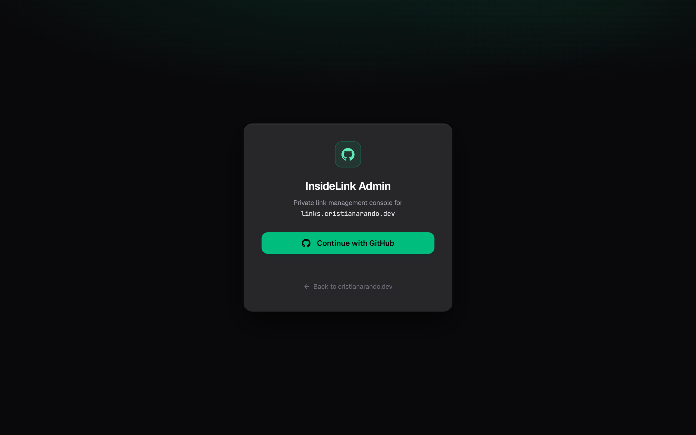
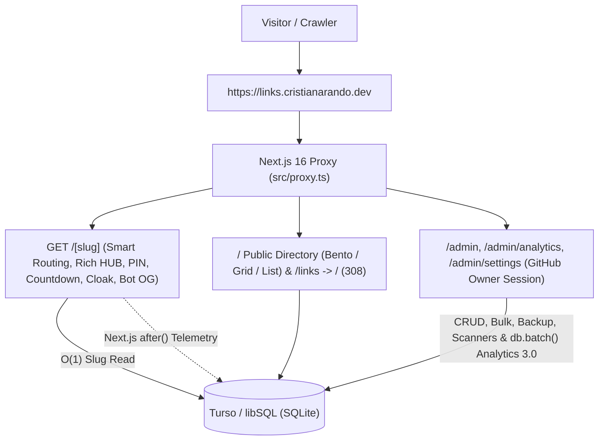

# InsideLink v2 — Smart Shortlinks, Rich Project HUBs & Analytics 3.0

[](https://nextjs.org/)
[](https://react.dev/)
[](https://turso.tech/)
[](https://orm.drizzle.team/)
[](https://tailwindcss.com/)
[](https://www.better-auth.com/)
[](https://vitest.dev/)
[](https://links.cristianarando.dev/)

**InsideLink v2** is a self-hosted, single-owner shortlink engine, polymorphic micro-landing platform (`type = 'HUB'`), visual theme studio, QR code generator, and Bento Mosaic directory deployed standalone on **`https://links.cristianarando.dev`** alongside **`https://cristianarando.dev`**.

Designed around a **Dark-Mode Obsidian Philosophy** (`#09090b` Obsidian canvas with `#10b981` Emerald precision defaults), InsideLink v2 eliminates SaaS bloat, tracking pixels, and external API keys—relying strictly on **GitHub OAuth** locked to a single owner (`ALLOWED_GITHUB_ID`).

---

## Visual Showcase

### 1. Private Admin Console (`/admin`)

_Manage links and Rich HUBs with `Cmd+K` command navigation, multi-select bulk actions, live slug collision checks, Magic URL metadata preview, destination health/frame scanners, and branded QR generation._


### 2. Analytics 3.0 & Telemetry (`/admin/analytics`)

_Zero-PII telemetry computed in a single `db.batch(...)` SQLite roundtrip: 7d/30d/90d KPIs with period deltas, 90-day GitHub-style activity heatmap, 24h UTC distribution, Top 10 Cities, HUB block CTR, `?ref=` attribution, Live Clicks Stream, and UTF-8 CSV export._


### 3. Public Bento Directory (`/`)

_Obsidian dark-mode directory featuring Bento/Grid/List layouts, SSR category tabs, debounced search, scheduled launch badges, and keyset-paginated infinite scroll (`/links` permanently redirects `308` → `/`)._


### 4. Rich Micro-Landing (`type = 'HUB'`)

_Multi-block project showcase with themed buttons, live cached GitHub repo cards, zero-tracker Click-to-Play YouTube & Spotify facades, copyable code snippets, callouts, and per-block CTR telemetry._


### 5. Security, Access & Lifecycle Views

|              Owner Login (`/login`)              |              PIN Protection Interstitial               |             Expired Link Notice (`HTTP 410`)              |
| :----------------------------------------------: | :----------------------------------------------------: | :-------------------------------------------------------: |
|  |  |  |

---

## InsideLink v2 Pro Feature Suite

1. **Theme & Customization Studio (`/admin/settings` & Per-HUB Overrides):**
   - **6 Curated Dark Presets:** `obsidian-emerald`, `midnight-cyan`, `cosmic-violet`, `solar-amber`, `crimson-oxide`, and `arctic-mono`.
   - **Visual Custom Theme Studio:** Live `#RRGGBB` custom accent HEX picker with automatic contrast calculation, surface tones (`obsidian`, `graphite`, `midnight`), glow intensity (`none`, `subtle`, `vibrant`), card styles (`glass`, `bordered`, `minimal`), live status badge (`statusText`, `statusColor`, `statusHref`), and verified social links.
   - **Per-Link / Per-HUB Theme Overrides (`theme_json`):** Customize preset, accent HEX, surface tone, and glow intensity on individual HUB, PIN, and Countdown pages.
2. **Bento Mosaic Directory & Dynamic Sitemap (`/` & `/sitemap.xml`):**
   - Switchable `bento`, `grid`, and `list` public layouts powered by `site_settings`, SSR category filtering (`project`, `social`, `resource`, `personal`, `temporary`), `300ms` debounced search, and `O(1)` keyset cursor pagination `(is_pinned DESC, id DESC)`.
   - Automatically publishes public, active, non-PIN `HUB` links in `/sitemap.xml`.
3. **6 Polymorphic Rich HUB Block Kinds (`type = 'HUB'`):**
   - **`button`:** Branded icon, primary label, optional `sublabel`, and outbound click beacon.
   - **`github-repo`:** Server-fetched repository card (`owner/repo`, description, language dot, stars, forks) with `15m` in-memory caching and graceful offline fallback.
   - **`youtube` & `spotify` (Click-to-Play Facades):** Privacy-first dark cover cards that mount `youtube-nocookie.com` / `open.spotify.com/embed` iframes on demand via `document.createElement("iframe")` while logging block CTR.
   - **`code` & `callout`:** Copyable terminal/code blocks with language headers and `info` / `tip` / `warning` callout notices.
4. **Smart Conditional Routing (`routing_rules_json`):**
   - Ordered routing rules evaluated against visitor `country` (`x-vercel-ip-country` / `cf-ipcountry`), `Accept-Language` (with `q=` priority weights), `device` (`mobile`, `desktop`, `tablet`), and `os` (`iOS`, `Android`, `Windows`, `macOS`, `Linux`) across both standard redirects and post-PIN unlocks.
5. **Scheduled Launch Countdowns & Expiration Fallbacks:**
   - **Scheduled Launch (`starts_at`):** Renders a themed live `dd : hh : mm : ss` countdown interstitial before launch without counting clicks, and marks public cards with a `"Launching soon"` badge.
   - **Expiration Fallback (`expired_redirect_url`):** Routes expired or `max_clicks`-exhausted links via `307` to a configured archive/waitlist URL without inflating `clicks_count`—or renders a themed `HTTP 410 Gone` page when omitted.
6. **Fullscreen Link Cloaking & SSRF-Safe Scanners (`src/server/services/metadata.service.ts`):**
   - **Clean Fullscreen Cloaking (`is_cloaked`):** Renders borderless `100vw × 100dvh` iframe embeds with custom `<title>`, favicon, and Open Graph tags.
   - **SSRF-Protected Frame, Health & Metadata Probes:** `/api/v1/links/frame-check` (`X-Frame-Options` & CSP `frame-ancestors`), `checkUrlHealth` (`healthy`, `redirect`, `broken`, `timeout` + latency), and `/api/v1/links/metadata-preview` strictly block `localhost`, RFC1918, CGNAT, link-local/cloud metadata (`169.254.169.254`), IPv6 ULA, and DNS-rebinding redirects.
7. **Admin Productivity (`Cmd+K`, Bulk Ops, Click Reset, QR Studio & Dry-Run Backup):**
   - Global `Cmd+K` / `Ctrl+K` command palette, multi-select bulk actions (`activate`, `pause`, `makePublic`, `makePrivate`, `setCategory`, `delete`), and per-link click + `click_events` reset.
   - Branded SVG & `1024×1024px` PNG QR Code Studio with Level `H` error correction, optional centered `</> CA` badge, and `?ref=` campaign attribution chips.
   - Non-destructive JSON Backup & Restore (`GET` / `POST /api/v1/links/backup`) omitting `passwordHash`, supporting `dryRun: true` previews and `"skip"` / `"update"` conflict strategies.
8. **`O(1)` `db.batch` Analytics 3.0:**
   - Single-roundtrip SQLite `COUNT`, `SUM`, and `GROUP BY` queries compute `totalClicksInRange`, `previousPeriodClicks`, `deltaPercentage`, `90d` activity heatmap, `24h` UTC hourly distribution, Top 10 Cities, Countries, Devices, OS, Browsers, Referrers, `?ref=` campaigns, HUB block CTR, Top Links, latest 25 zero-PII Live Clicks Stream events, and UTF-8 CSV export.
9. **Single-Owner GitHub OAuth & Hardened PIN Security:**
   - Better-Auth `databaseHooks` reject any GitHub login not matching `ALLOWED_GITHUB_ID` / `ALLOWED_GITHUB_EMAIL` before user or session rows are created—no external Bearer API keys exist.
   - PINs use `scrypt` + `timingSafeEqual` (`src/server/crypto/pin.ts`), stateless `HttpOnly` HMAC-SHA256 unlock cookies (`src/server/crypto/pin-token.ts`), and UTC-day atomic SQLite rate limiting (`5` failed attempts / `60s` in `src/server/crypto/rate-limit.ts`).

---

## Architecture & Technology Stack



| Layer                         | Technology                                                              | Purpose                                                                                           |
| :---------------------------- | :---------------------------------------------------------------------- | :------------------------------------------------------------------------------------------------ |
| **Runtime & Package Manager** | Node.js `v24.x` LTS + `pnpm`                                            | Native ESM, `node:crypto`, deterministic lockfile                                                 |
| **Full-Stack Framework**      | Next.js `16.4.3` + React `19.3.0`                                       | App Router, `src/proxy.ts`, async `params`, Server Components, `after()` API                      |
| **Database & ORM**            | Turso (`@libsql/client`) + Drizzle ORM `0.45.4`                         | Local `file:local.db` / `:memory:` in dev & tests; libSQL in production; migrations `0000`–`0003` |
| **Authentication**            | Better-Auth (`1.7.x`)                                                   | Single-owner GitHub OAuth (`ALLOWED_GITHUB_ID` fail-closed guard)                                 |
| **Styling & UI**              | Tailwind CSS v4 + Lucide React                                          | Obsidian dark-only design system, 6 presets, Bento Mosaic layouts                                 |
| **Validation & Security**     | Zod + `ulidx` + `node:crypto`                                           | Monotonic ULIDs, strict URL/slug validation, SSRF guards, `scrypt` & `HMAC-SHA256`                |
| **Testing & Quality Gates**   | Vitest (`106` tests / `27` suites) + ESLint 9 + Prettier + TypeScript 5 | Unit, `:memory:` SQLite integration, E2E route specs, strict typechecking                         |

---

## Quickstart & Local Development

### Prerequisites

- Node.js `>= 20.18.0` (Recommended: `24.x` LTS)
- `pnpm >= 9.x`

### 1. Install Dependencies

```bash
git clone git@github.com:cristianarando/inside-link.git
cd inside-link
pnpm install
```

### 2. Configure Environment Variables

Copy `.env.example` to `.env` and fill in your local values:

```bash
cp .env.example .env
```

```ini
# Database (Turso / libSQL) — keep file:local.db for local development
TURSO_DATABASE_URL="file:local.db"
TURSO_AUTH_TOKEN=""

# Authentication (Better-Auth + GitHub OAuth)
BETTER_AUTH_SECRET="your_better_auth_secret_minimum_32_characters_long"
BETTER_AUTH_URL="http://localhost:3000"
GITHUB_CLIENT_ID="your_github_oauth_client_id"
GITHUB_CLIENT_SECRET="your_github_oauth_client_secret"

# Single-Owner Guard (Required)
ALLOWED_GITHUB_ID="12345678"
ALLOWED_GITHUB_EMAIL="owner@example.com"

# Canonical Domain & Portfolio URL
NEXT_PUBLIC_CANONICAL_URL="https://links.cristianarando.dev"
NEXT_PUBLIC_PORTFOLIO_URL="https://cristianarando.dev"
NEXT_PUBLIC_ASSET_PREFIX=""
```

### 3. Apply Migrations & Seed Local SQLite

> [!CAUTION]
> **Database Safety Warning:** If your `.env` points `TURSO_DATABASE_URL` to a remote Turso Cloud database (`libsql://...` or `https://...`), **always** override `TURSO_DATABASE_URL="file:local.db"` for local migration/seeding. `pnpm db:seed` enforces a built-in remote wipe guard and exits with code `1` against remote URLs unless `--allow-remote-wipe` is explicitly passed.

```bash
# Apply Drizzle migrations (0000–0003) to local.db
TURSO_DATABASE_URL="file:local.db" pnpm db:migrate

# Seed local.db with sample v2 links (DIRECT, HUB, PIN, Scheduled, Cloaked, Smart-Routed)
TURSO_DATABASE_URL="file:local.db" pnpm db:seed
```

### 4. Start Development Server

```bash
pnpm dev
```

Available local routes:

- **Public Bento Directory**: [http://localhost:3000](http://localhost:3000) (`/links` redirects `308` to `/`)
- **Admin Dashboard**: [http://localhost:3000/admin](http://localhost:3000/admin)
- **Analytics 3.0**: [http://localhost:3000/admin/analytics](http://localhost:3000/admin/analytics)
- **Theme & Backup Studio**: [http://localhost:3000/admin/settings](http://localhost:3000/admin/settings)

---

## Available Scripts & Verification Gates

| Script               | Command                              | Description                                                                  |
| :------------------- | :----------------------------------- | :--------------------------------------------------------------------------- |
| **Dev Server**       | `pnpm dev`                           | Starts Next.js 16 development server                                         |
| **Production Build** | `pnpm build`                         | Builds Next.js App Router bundle and `src/proxy.ts`                          |
| **Start Production** | `pnpm start`                         | Runs the compiled production server                                          |
| **Test Suite**       | `pnpm test` (`pnpm exec vitest run`) | Runs all `27` Vitest suites (`106` unit, `:memory:` integration & E2E tests) |
| **Test Watch**       | `pnpm test:watch`                    | Runs Vitest in interactive watch mode                                        |
| **Typecheck**        | `pnpm typecheck`                     | Strict `tsc --noEmit` verification                                           |
| **Lint**             | `pnpm lint`                          | Runs ESLint 9 across `src` and `tests`                                       |
| **Format Check**     | `pnpm format:check`                  | Checks Prettier formatting across `src`, `tests`, and `eslint.config.mjs`    |
| **DB Migrate**       | `pnpm db:migrate`                    | Applies Drizzle SQLite migrations (`src/server/db/migrations`)               |
| **DB Seed**          | `pnpm db:seed`                       | Seeds local SQLite fixtures (protected against accidental remote wipes)      |

---

## Engineering Documentation Index

Comprehensive architecture and specification documents live in [`docs/`](docs/):

- [docs/README.md](docs/README.md) — Engineering documentation suite overview and request-flow summary.
- [docs/01-product-requirements.md](docs/01-product-requirements.md) — Product vision, v1 → v2 evolution, actors, `FR-001`–`FR-017`, and `NFR-001`–`NFR-006`.
- [docs/02-system-architecture.md](docs/02-system-architecture.md) — Standalone topology, `src/proxy.ts`, `after()` telemetry, and C4 architecture diagrams.
- [docs/03-data-model-and-invariants.md](docs/03-data-model-and-invariants.md) — Turso/SQLite schema, ERD (`site_settings`, `links`, `click_events`, `pin_attempts`), JSON contracts, and keyset cursor SQL.
- [docs/04-api-and-redirect-engine.md](docs/04-api-and-redirect-engine.md) — Slug normalization, `GET /[slug]` resolution state machine, Smart Routing, Rich HUB blocks, and `/api/v1/*` contracts.
- [docs/05-security-and-operations.md](docs/05-security-and-operations.md) — Single-owner GitHub OAuth lock, zero-API-key policy, SSRF outbound guards, `scrypt` + HMAC PIN cookies, and QA runbook.
- [docs/decisions/stack-versions.md](docs/decisions/stack-versions.md) — Pinned runtime and dependency version ADR.

---

## License

Proprietary software — Designed & Developed by [Cristian Arando](https://cristianarando.dev). All rights reserved.
