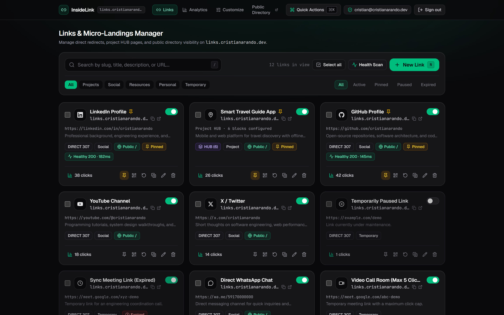
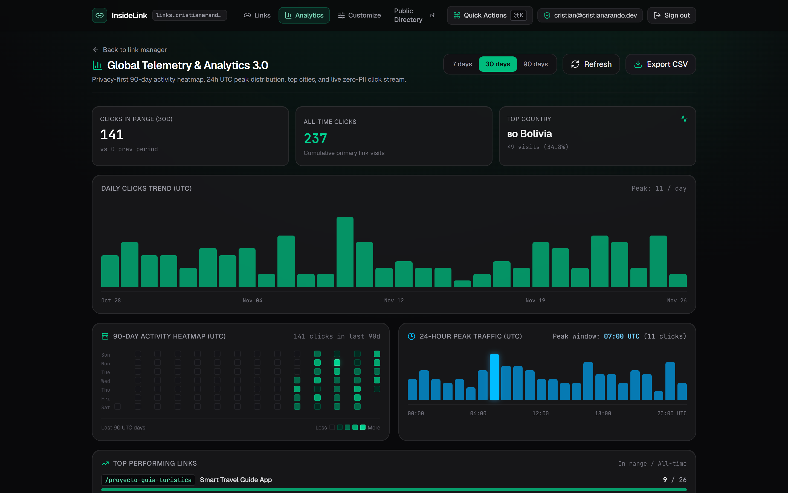
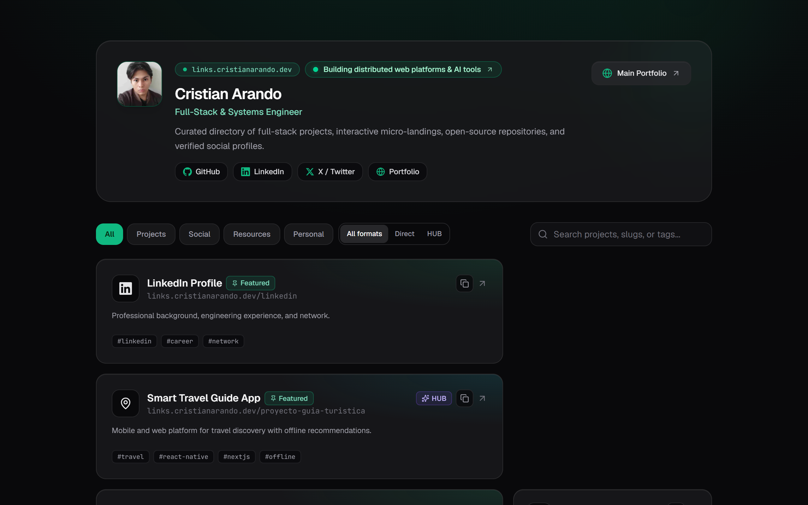
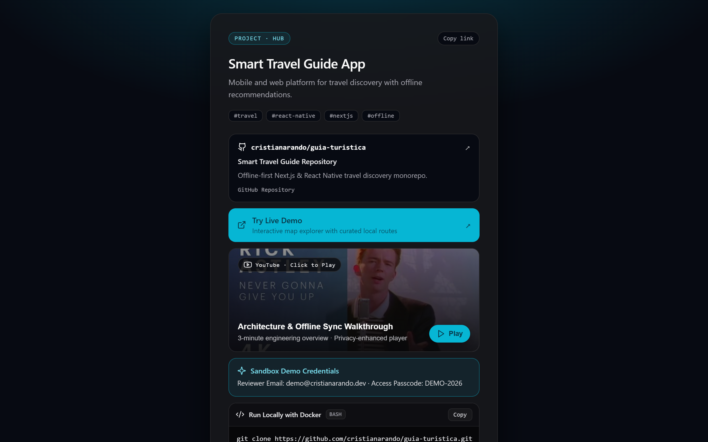
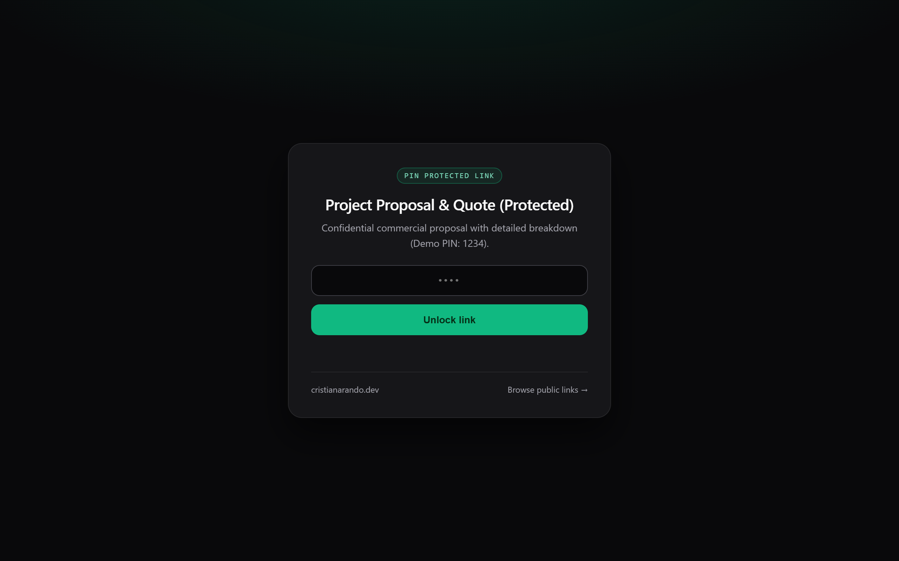
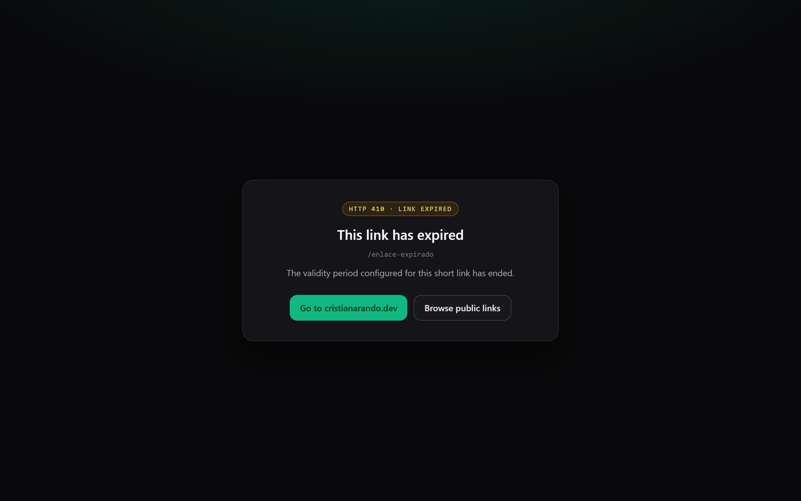
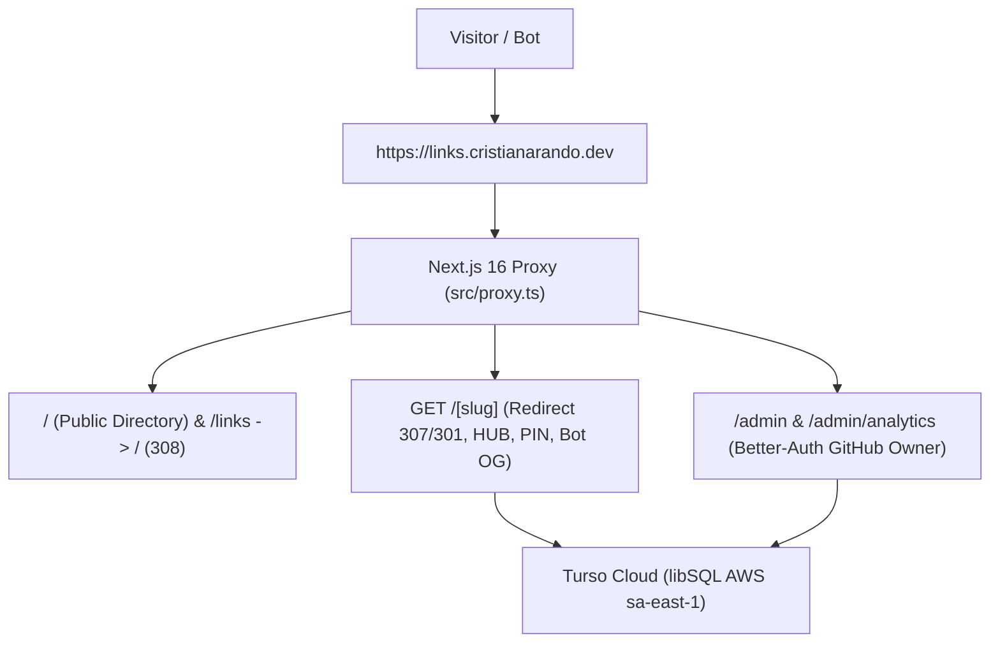

# InsideLink — Custom Link Shortener, Project Hubs & Public Directory

[](https://nextjs.org/)
[](https://react.dev/)
[](https://turso.tech/)
[](https://orm.drizzle.team/)
[](https://tailwindcss.com/)
[](https://www.better-auth.com/)
[](https://vitest.dev/)
[](https://links.cristianarando.dev/)

**InsideLink** is a self-hosted, single-owner link shortening platform, project micro-landing hub (`type = 'HUB'`), branded vector/PNG QR code studio, and public directory (`/`) deployed standalone on **`https://links.cristianarando.dev`** alongside the primary portfolio **`https://cristianarando.dev`**.

---

## 📸 Visual Showcase

### 1. Private Admin Console (`/admin`)
*Manage shortlinks with real-time slug collision checks, live search debouncing, custom icon selector, Magic URL metadata preview, and instant QR generation.*



---

### 2. Global Analytics & Telemetry (`/admin/analytics`)
*Zero-raw-IP privacy-first telemetry powered by `O(1)` SQLite aggregations, interactive 7d/30d/90d click trends with period-over-period delta, HUB button CTR, `?ref=` campaign attribution, and UTF-8 CSV export.*



---

### 3. Public Links Directory (`/`)
*Obsidian & Emerald dark-mode showcase for visitors featuring category tabs (Projects, Social, Resources), real-time search, and keyset-based infinite scroll. Legacy `/links` requests permanently redirect (`308`) to `/`.*



---

### 4. Interactive Micro-Landing (`type = 'HUB'`)
*Multi-action intermediate showcase for complex projects (`links.cristianarando.dev/proyecto-guia-turistica`) with per-button outbound CTR telemetry.*



---

### 5. Security & Expiration Controls
| PIN Protection Interstitial | Expired Link Notice (`HTTP 410 Gone`) |
| :---: | :---: |
|  |  |

---

## ⚡ Key Architectural Highlights

1. **Standalone Subdomain Deployment (`links.cristianarando.dev`):**
   Runs directly on its own subdomain with `/` as the canonical public directory (`/links` -> `/` permanent `308` redirect in `next.config.ts`). Former portfolio slugs (`/projects`, `/uses`, `/blog`, `/cv`, etc.) are available for shortening without cross-project rewrite rules.
2. **Next.js `16.4.3` Request Proxy (`src/proxy.ts`):**
   Replaces legacy `middleware.ts` with `export function proxy(request: NextRequest)` to enforce `X-Content-Type-Options: nosniff`, `Referrer-Policy: strict-origin-when-cross-origin`, and automatic `X-Robots-Tag: noindex, nofollow` on `*.vercel.app` preview hosts.
3. **Obsidian & Emerald Dark UI:**
   High-contrast dark-only interface (`#09090b` Obsidian base with `#10b981` Emerald accents) across the public directory, HUB landings, PIN interstitials, and `/admin` console.
4. **Hardened PIN Protection & Atomic Rate Limiting:**
   - `scrypt` key derivation with cryptographic salt and `timingSafeEqual` verification (`src/server/crypto/pin.ts`).
   - Stateless HMAC-SHA256 unlock tokens (`il_unlock_<linkId>`, `HttpOnly`, `SameSite=Lax`, 15-minute TTL) issued by `POST /api/v1/slug/[slug]/unlock` and required for PIN-protected `hub-click` events (`src/server/crypto/pin-token.ts`).
   - Atomic SQLite rate limiting (`src/server/crypto/rate-limit.ts`) using UTC-day salted SHA-256 keys (`pin_attempts`), `ON CONFLICT(key) DO UPDATE` upserts (`5` attempts / `60s`), and stale-row pruning.
5. **`O(1)` SQLite Analytics Engine & CSV Export (`src/server/services/analytics.service.ts`):**
   Parallel `db.batch([...])` SQLite `COUNT`, `SUM`, and `GROUP BY` queries compute `totalClicksInRange`, `previousPeriodClicks`, `deltaPercentage`, `hubSubLinkClicks`, `subLinks` (resolved to button labels), `countries`, `devices`, `os`, `browsers`, `referrers`, `queryRefs` (`?ref=`), and `topLinks`—with full UTF-8 CSV export from both global analytics and per-link drawers.
6. **SSRF-Protected Magic URL Metadata Preview (`src/server/services/metadata.service.ts`):**
   `POST /api/v1/links/metadata-preview` auto-fills link `title`, `description`, and suggested `icon` from destination URLs while blocking loopback, RFC1918, CGNAT, link-local/cloud metadata (`169.254.169.254`), IPv6 ULA/link-local, non-HTTP schemes, and DNS-rebinded targets across redirects.
7. **Branded QR Studio with `?ref=` Attribution (`src/lib/qr-generator.ts`):**
   Generates vector SVG and `1024×1024px` PNG QR codes pointing to canonical `https://links.cristianarando.dev/[slug]` with Level `H` (30%) error correction, optional centered `</> CA` badge, and `?ref=` campaign attribution chips.
8. **Single-Owner GitHub OAuth Lockdown:**
   Strictly enforced via Better-Auth `databaseHooks` blocking any account or user whose GitHub ID or email does not match `ALLOWED_GITHUB_ID` / `ALLOWED_GITHUB_EMAIL`.
9. **Compound Keyset Pagination & Local SQLite Safety:**
   Infinite scroll driven by `(is_pinned DESC, id DESC)` over monotonic **ULIDs**, local `PRAGMA foreign_keys = ON` enforcement for `file:` databases, and remote Turso protection on `db:seed`.

---

## 🛠️ Technology Stack

| Layer | Technology |
| :--- | :--- |
| **Runtime & Package Manager** | Node.js `v24.x` LTS + `pnpm` |
| **Full-Stack Framework** | Next.js `16.4.3` (App Router, `src/proxy.ts`, `after()` API) + React `19.3.0` |
| **Edge Database** | Turso (`@libsql/client` SQLite/libSQL) + Drizzle ORM `0.45.4` |
| **Authentication** | Better-Auth (`GitHub OAuth` locked to `ALLOWED_GITHUB_ID`) |
| **Validation & Cryptography** | Zod + `ulidx` (Monotonic ULIDs) + `node:crypto` (`scrypt`, `HMAC-SHA256`, `timingSafeEqual`) |
| **Styling & Icons** | Tailwind CSS v4 + Lucide React + Custom SVG Brand Icons |
| **Testing & Quality Gates** | Vitest (90 Unit, Integration, and E2E tests across 25 suites) + ESLint + Prettier + TypeScript |

---

## 🚀 Quickstart & Local Development

### Prerequisites
- Node.js $\ge$ `20.18.0` (Recommended: `24.x`)
- `pnpm` $\ge$ `9.x`

### 1. Clone & Install Dependencies
```bash
git clone git@github.com:cristianarando/inside-link.git
cd inside-link
pnpm install
```

### 2. Environment Configuration
Copy the template environment variables:
```bash
cp .env.example .env
```

Default `.env.example` variables:
```ini
# Database (Turso / libSQL)
# Local development default: file:local.db
TURSO_DATABASE_URL="file:local.db"
TURSO_AUTH_TOKEN=""

# Authentication (Better-Auth + GitHub OAuth)
BETTER_AUTH_SECRET="your_better_auth_secret_minimum_32_characters_long"
BETTER_AUTH_URL="http://localhost:3000"
GITHUB_CLIENT_ID="your_github_oauth_client_id"
GITHUB_CLIENT_SECRET="your_github_oauth_client_secret"

# Single-Owner Guard (Required)
ALLOWED_GITHUB_ID="12345678"
ALLOWED_GITHUB_EMAIL="owner@example.com"

# Canonical Domain & Portfolio URL
NEXT_PUBLIC_CANONICAL_URL="https://links.cristianarando.dev"
NEXT_PUBLIC_PORTFOLIO_URL="https://cristianarando.dev"
NEXT_PUBLIC_ASSET_PREFIX=""
```

### 3. Run SQLite Migrations & Seed Local Data
```bash
# Apply Drizzle migrations to local.db
TURSO_DATABASE_URL="file:local.db" pnpm db:migrate

# Seed local.db with sample links (DIRECT, HUB, PIN, Expired) and click events
# Note: db:seed refuses to run against remote libsql:// or https:// URLs without --allow-remote-wipe
TURSO_DATABASE_URL="file:local.db" pnpm db:seed
```

### 4. Start Development Server
```bash
pnpm dev
```
Open [http://localhost:3000](http://localhost:3000) in your browser:
- **Public Directory**: [http://localhost:3000](http://localhost:3000) (`/links` redirects `308` to `/`)
- **Admin Dashboard**: [http://localhost:3000/admin](http://localhost:3000/admin)
- **Global Analytics**: [http://localhost:3000/admin/analytics](http://localhost:3000/admin/analytics)
- **HUB Demo**: [http://localhost:3000/proyecto-guia-turistica](http://localhost:3000/proyecto-guia-turistica)

---

## 🧪 Testing & Verification

The project includes **90 automated tests across 25 test files** covering unit utilities, SSRF defenses, PIN security hardening, SQLite `GROUP BY` analytics aggregations, database invariants, route handlers, and end-to-end user journeys:

```bash
# Run ESLint across src and tests
pnpm lint

# Check Prettier formatting across src, tests, and eslint.config.mjs
pnpm format:check

# Run strict TypeScript typechecking
pnpm typecheck

# Run full Vitest test suite (Unit + Integration + E2E)
pnpm test

# Production build verification
pnpm build
```

---

## 🌐 Production Deployment Architecture

InsideLink is deployed as an independent Next.js `16.4.3` application on Vercel serving `https://links.cristianarando.dev`, backed by Turso Cloud (`libSQL`):



### Required Production Environment Variables

| Variable | Description | Example |
| :--- | :--- | :--- |
| `TURSO_DATABASE_URL` | Turso libSQL connection URL (`file:local.db` locally) | `libsql://your-db-name-org.turso.io` |
| `TURSO_AUTH_TOKEN` | Read/write Turso database token (empty locally) | `your_turso_auth_token` |
| `BETTER_AUTH_SECRET` | 32+ character random secret (also signs PIN unlock cookies) | `openssl rand -base64 32` |
| `BETTER_AUTH_URL` | Canonical Better-Auth root URL | `https://links.cristianarando.dev` |
| `GITHUB_CLIENT_ID` | GitHub OAuth App Client ID | `your_github_oauth_client_id` |
| `GITHUB_CLIENT_SECRET` | GitHub OAuth App Secret | `your_github_oauth_client_secret` |
| `ALLOWED_GITHUB_ID` | Owner's immutable GitHub user ID | `12345678` |
| `ALLOWED_GITHUB_EMAIL` | Owner's verified email address | `owner@example.com` |
| `NEXT_PUBLIC_CANONICAL_URL` | Canonical shortlink & directory origin | `https://links.cristianarando.dev` |
| `NEXT_PUBLIC_PORTFOLIO_URL` | Primary portfolio origin linked in headers/footers | `https://cristianarando.dev` |
| `NEXT_PUBLIC_ASSET_PREFIX` | Optional CDN/asset prefix for Next.js static assets | `""` |

---

## 📚 Technical Documentation Index

Detailed engineering specifications are available in the [`docs/`](docs/) directory:

- [docs/README.md](docs/README.md) — Architectural suite overview and guidelines.
- [docs/01-requerimientos-y-producto.md](docs/01-requerimientos-y-producto.md) — 24 Functional and 12 Non-Functional Requirements.
- [docs/02-arquitectura-del-sistema.md](docs/02-arquitectura-del-sistema.md) — C4 Architecture models and zero-collision strategy.
- [docs/03-modelo-de-datos-e-invariantes.md](docs/03-modelo-de-datos-e-invariantes.md) — Turso/SQLite database schema, indices, and compound cursor pagination.
- [docs/04-api-flujos-y-motor-redireccion.md](docs/04-api-flujos-y-motor-redireccion.md) — Slug normalization pipeline and REST contracts.
- [docs/05-seguridad-operaciones-y-testing.md](docs/05-seguridad-operaciones-y-testing.md) — Single-owner security model, `scrypt` hashing, and privacy-first telemetry.
- [docs/06-backlog-de-tareas.md](docs/06-backlog-de-tareas.md) — Full standardized 24-task engineering backlog (`T-001` to `T-024`).
- [docs/implementation-status.md](docs/implementation-status.md) — Implementation status log (`24/24 COMPLETE`).

---

## 📄 License

Proprietary software — Designed & Developed by [Cristian Arando](https://cristianarando.dev). All rights reserved.
