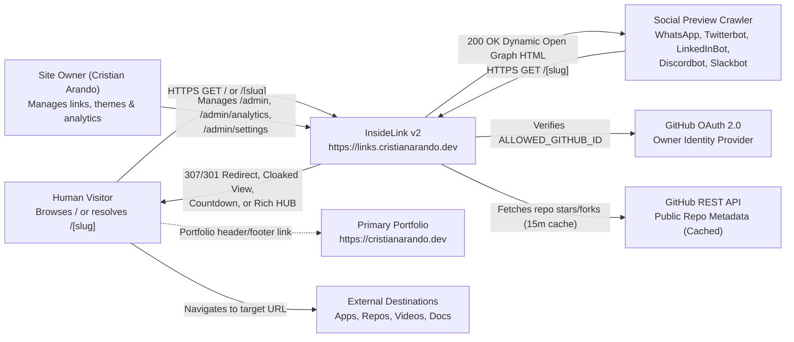
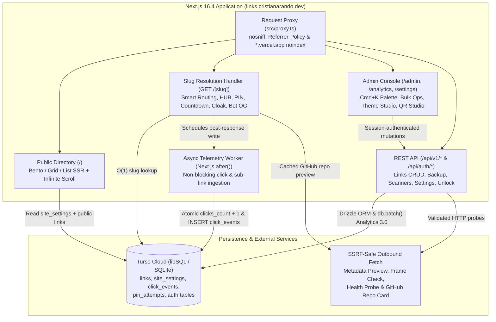

# InsideLink v2 — System Architecture & Topology

> **Document ID:** `docs/02-system-architecture.md`  
> **Production Origin:** `https://links.cristianarando.dev`  
> **Related Specifications:** [`01-product-requirements.md`](01-product-requirements.md) · [`03-data-model-and-invariants.md`](03-data-model-and-invariants.md) · [`04-api-and-redirect-engine.md`](04-api-and-redirect-engine.md) · [`decisions/stack-versions.md`](decisions/stack-versions.md)

---

## 1. Architectural Overview

**InsideLink v2** is a modular full-stack monolith built on **Next.js 16.4.3 (App Router)** and **React 19.3**, backed by **Turso (`@libsql/client` distributed SQLite)** and **Drizzle ORM**, deployed as an independent application on **`https://links.cristianarando.dev`**.

### Key Architectural Decisions

1. **Standalone Subdomain (`links.cristianarando.dev`):** Decouples shortlink routing, authentication cookies, and static bundles completely from the primary portfolio (`https://cristianarando.dev`). `/` serves the public Bento directory directly, while legacy `/links` requests issue a permanent `308` redirect to `/`.
2. **Next.js 16 Request Proxy (`src/proxy.ts`):** Uses Next.js 16's native `proxy(request: NextRequest)` convention (replacing legacy `middleware.ts`) to attach baseline security headers (`X-Content-Type-Options: nosniff`, `Referrer-Policy: strict-origin-when-cross-origin`) and inject `X-Robots-Tag: noindex, nofollow` whenever accessed via technical `*.vercel.app` preview domains.
3. **Critical-Path Separation via `after()`:** `GET /[slug]` performs a single indexed lookup by `slug` (plus cached `site_settings` when rendering themed HTML) and returns the HTTP redirect or SSR document immediately, deferring `clicks_count` increments and `click_events` inserts to Next.js `after()`.
4. **Zero-JS/Minimal-JS Themed SSR Views:** Public interstitials (`HUB` micro-landings, `PIN` unlock screens, `SCHEDULED` countdowns, and `CLOAKED` fullscreen iframes) are rendered as self-contained, CSP-friendly HTML documents styled via resolved CSS custom properties (`resolveThemeTokens`)—avoiding heavy React hydration payloads on shortlink hits.
5. **Session-Only Owner Auth (No External API Keys):** Administrative endpoints authenticate exclusively against Better-Auth `HttpOnly` sessions locked to `ALLOWED_GITHUB_ID`, eliminating long-lived Bearer tokens.

---

## 2. Locked Technology Stack

See [`decisions/stack-versions.md`](decisions/stack-versions.md) for the exact version registry.

| Layer                 | Technology                                  | Role & Architectural Boundary                                                                                           |
| :-------------------- | :------------------------------------------ | :---------------------------------------------------------------------------------------------------------------------- |
| **Runtime & Tooling** | Node.js `v24.11.1` LTS + `pnpm 12.x`        | Native ESM, `node:crypto` (`scrypt`, `HMAC-SHA256`, `timingSafeEqual`), and deterministic lockfile builds.              |
| **Web Framework**     | Next.js `16.4.3` + React `19.3.0`           | App Router, async `params`/`searchParams`, `src/proxy.ts`, Server Components, Route Handlers, and `after()`.            |
| **Edge Database**     | Turso (`@libsql/client`)                    | Local `file:local.db` / `:memory:` in dev & tests; HTTPS/WebSocket replica connection in production (`aws-sa-east-1`).  |
| **ORM & Migrations**  | Drizzle ORM + `drizzle-kit`                 | Zero-binary SQL builder, strict TypeScript inference, `db.batch([...])` roundtrips, and SQL migrations (`0000`–`0003`). |
| **Authentication**    | Better-Auth (`better-auth`)                 | GitHub OAuth 2.0 provider with fail-closed `ALLOWED_GITHUB_ID` / `ALLOWED_GITHUB_EMAIL` database hooks.                 |
| **Validation & IDs**  | Zod + `ulidx`                               | Shared client/server schema contracts and 26-char monotonic ULIDs enabling keyset pagination.                           |
| **UI & Styling**      | Tailwind CSS v4 + Lucide React              | Dark-only _Obsidian & Emerald_ design system + 6 presets, custom HEX theming, and Bento Mosaic layouts.                 |
| **QR & OG Imaging**   | `qrcode` + Next.js `ImageResponse`          | Vector SVG / `1024×1024` PNG QR codes with Level `H` error correction and dynamic edge Open Graph PNG cards.            |
| **Quality & Testing** | Vitest + ESLint 9 + Prettier + TypeScript 5 | Unit, SQLite integration, and end-to-end verification gates.                                                            |

---

## 3. C4 Architecture Diagrams

### 3.1. Level 1 — System Context Diagram



### 3.2. Level 2 — Container & Request Flow Architecture



### 3.3. Level 3 — Domain Services & Shared Libraries

```mermaid
flowchart TD
    subgraph Libs["Shared Pure Modules (src/lib/)"]
        Themes["themes.ts\n6 Dark Presets, Custom HEX & CSS Vars"]
        SmartRouting["smart-routing.ts\nCountry / Language / Device / OS Matcher"]
        EmbedParsers["embed-parsers.ts\nYouTube, Spotify & GitHub URL Parsers"]
        Validators["validations/* & reserved-slugs.ts\nZod Contracts & Slug Blacklist"]
        TelemetryParsers["bot-detector.ts, geo-headers.ts & cursor.ts\nCrawler Detection, Privacy Geo & Keyset Codec"]
    end

    subgraph Services["Server Domain Services (src/server/)"]
        LinkSvc["link.service.ts\nCRUD, Keyset Pagination, Bulk Ops,\nDry-Run Backup & Click Reset"]
        ResSvc["resolution.service.ts\nState Machine: DIRECT, Smart Route, HUB,\nPIN, Scheduled, Expired Fallback & Cloak"]
        SettingsSvc["settings.service.ts\nGlobal Profile, Theme Studio & Layout"]
        AnalyticsSvc["analytics.service.ts\ndb.batch() KPIs, 90d Heatmap, 24h UTC,\nTop Cities, HUB CTR & Live Stream"]
        ScannerSvc["metadata.service.ts & github-repo.service.ts\nSSRF Guard, Magic Fill, Frame Check,\nHealth Probe & GitHub Card Cache"]
        CryptoMod["crypto/pin.ts, pin-token.ts & rate-limit.ts\nscrypt, HMAC Unlock Cookie & Atomic Limiter"]
    end

    LinkSvc --> Validators
    LinkSvc --> TelemetryParsers
    ResSvc --> SmartRouting
    ResSvc --> Themes
    ResSvc --> EmbedParsers
    ResSvc --> CryptoMod
    SettingsSvc --> Themes
    AnalyticsSvc --> TelemetryParsers
    ScannerSvc --> EmbedParsers
```



---

## 4. Repository Structure

```text
inside-link/
├── docs/                                       # 100% English v2 engineering documentation
│   ├── README.md                               # Architecture index & visual system map
│   ├── 01-product-requirements.md              # Product scope, FRs & NFRs
│   ├── 02-system-architecture.md               # Topology, C4 diagrams & repo map
│   ├── 03-data-model-and-invariants.md         # Turso/Drizzle schema, ERD & SQL invariants
│   ├── 04-api-and-redirect-engine.md           # Resolution state machine & REST API contracts
│   ├── 05-security-and-operations.md           # Auth, SSRF, PIN crypto, env & runbooks
│   ├── decisions/
│   │   └── stack-versions.md                   # Frozen dependency & runtime registry
│   └── screenshots/                            # High-DPI UI showcase captures
├── public/
│   └── brand/                                  # Brand marks, avatar & QR center badge
├── scripts/
│   ├── capture-screenshots.mjs                 # Puppeteer capture for public routes
│   └── capture-admin-screenshots.mjs           # Puppeteer capture for /admin routes
├── src/
│   ├── proxy.ts                                # Next.js 16 request proxy & security headers
│   ├── app/
│   │   ├── (public)/
│   │   │   ├── page.tsx                        # Canonical public directory (/) — Bento/Grid/List
│   │   │   └── [slug]/route.ts                 # High-speed GET /[slug] resolution handler
│   │   ├── (admin)/
│   │   │   ├── admin/
│   │   │   │   ├── layout.tsx                  # Owner session guard + AdminNav + Cmd+K
│   │   │   │   ├── page.tsx                    # Links console, Bulk bar, Health & QR Studio
│   │   │   │   ├── analytics/page.tsx          # Analytics 3.0 dashboard, Heatmap & Live Stream
│   │   │   │   └── settings/page.tsx           # Theme & Customization Studio + JSON Backup
│   │   │   └── login/page.tsx                  # Single-owner GitHub OAuth sign-in
│   │   ├── api/
│   │   │   ├── auth/[...all]/route.ts          # Better-Auth OAuth handler
│   │   │   └── v1/
│   │   │       ├── settings/route.ts           # GET / PUT global site & theme settings
│   │   │       ├── links/
│   │   │       │   ├── route.ts                # GET cursor list / POST create link
│   │   │       │   ├── public/route.ts         # GET public directory cursor feed
│   │   │       │   ├── check-slug/route.ts     # GET real-time slug availability
│   │   │       │   ├── metadata-preview/route.ts # POST SSRF-safe URL title/desc/icon preview
│   │   │       │   ├── frame-check/route.ts    # POST SSRF-safe X-Frame-Options & CSP check
│   │   │       │   ├── bulk/route.ts           # POST batch link actions
│   │   │       │   ├── backup/route.ts         # GET JSON export / POST dry-run & restore
│   │   │       │   └── [id]/
│   │   │       │       ├── route.ts            # PATCH update / DELETE cascade
│   │   │       │       ├── analytics/route.ts  # GET global ('overview') or per-link analytics
│   │   │       │       ├── health/route.ts     # POST on-demand link health check (or batch)
│   │   │       │       └── reset-clicks/route.ts # POST zero clicks_count & clear click_events
│   │   │       ├── og/...                      # Dynamic Edge Open Graph PNG generators
│   │   │       └── slug/[slug]/
│   │   │           ├── unlock/route.ts         # POST PIN verification + HMAC cookie + smart route
│   │   │           └── hub-click/route.ts      # POST sub-link / embed / snippet click beacon
│   │   ├── robots.ts                           # Canonical robots.txt rules
│   │   └── sitemap.ts                          # Dynamic sitemap including public HUB landings
│   ├── components/
│   │   ├── admin/                              # Dashboard, Modals, CommandPalette, Settings, Charts
│   │   ├── hub/                                # SSR HTML builders (HUB, PIN, Countdown, Cloaked, 410)
│   │   ├── public-links/                       # Bento/Grid/List public directory components
│   │   └── ui/                                 # Accessible dark-mode UI primitives
│   ├── lib/                                    # Pure domain helpers (themes, smart-routing, embeds, zod)
│   └── server/                                 # Auth, crypto, Drizzle DB & domain services
└── tests/                                      # Vitest unit, integration & E2E suites
```
