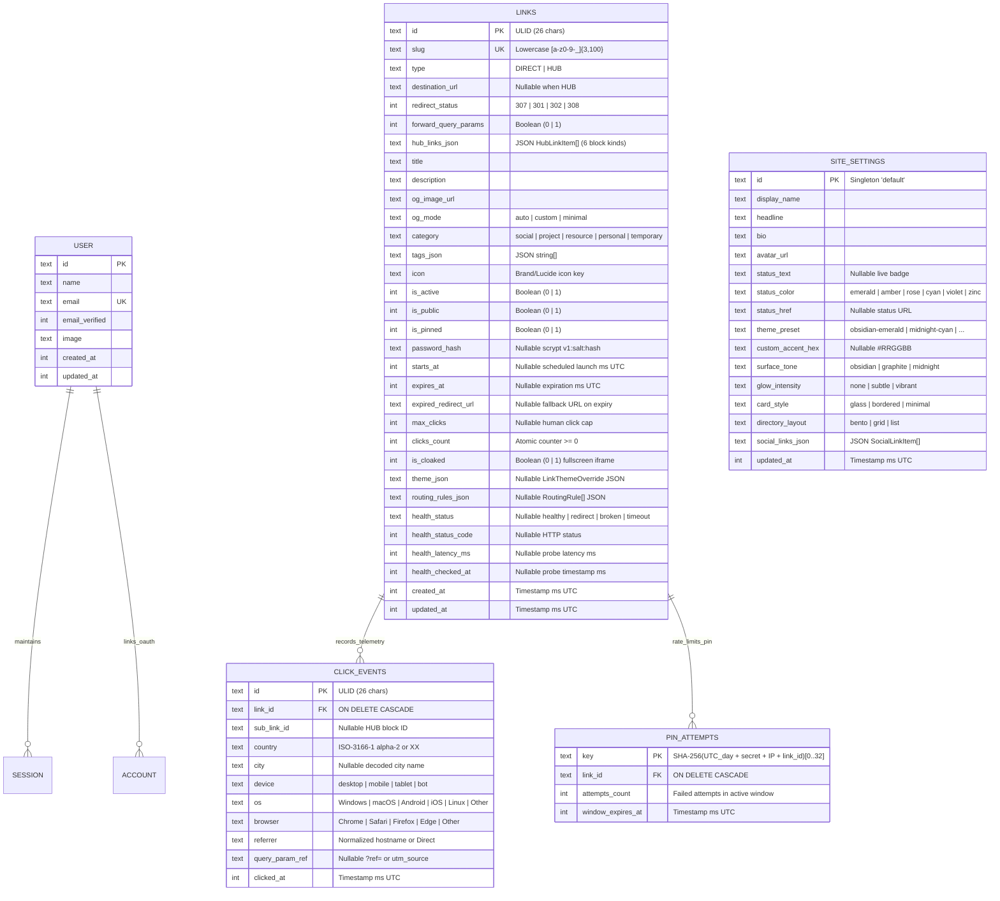

# InsideLink v2 — Data Model & Persistence Invariants

> **Document ID:** `docs/03-data-model-and-invariants.md`  
> **Database Engine:** Turso (`@libsql/client`, SQLite 3.45+ compatible) + Drizzle ORM (`drizzle-orm/sqlite-core`)  
> **Schema Source:** `src/server/db/schema.ts` & `src/server/db/migrations/0000..0003`  
> **Related Specifications:** [`02-system-architecture.md`](02-system-architecture.md) · [`04-api-and-redirect-engine.md`](04-api-and-redirect-engine.md)

---

## 1. SQLite / libSQL Persistence Conventions

| Dimension               | Standardized Convention                                                                                                                                                                                             |
| :---------------------- | :------------------------------------------------------------------------------------------------------------------------------------------------------------------------------------------------------------------ |
| **Primary Keys (`id`)** | **ULID** (`TEXT`, 26 chars, e.g., `01J...`) generated via `ulidx` for domain entities (`links`, `click_events`), and singleton `"default"` for `site_settings`. Lexicographically sortable by creation millisecond. |
| **Column Naming**       | `snake_case` in SQLite DDL and indexes; `camelCase` properties in Drizzle TypeScript models.                                                                                                                        |
| **Timestamps**          | `integer("...", { mode: "timestamp_ms" })` storing UTC Unix epoch milliseconds for fast integer range comparisons (`expires_at <= :now_ms`, `starts_at > :now_ms`).                                                 |
| **Booleans**            | `integer("...", { mode: "boolean" })` (`0` or `1`) with explicit `NOT NULL` defaults.                                                                                                                               |
| **Structured JSON**     | `text("...")` serialized/parsed in domain services and strictly validated via Zod (`hub_links_json`, `tags_json`, `theme_json`, `routing_rules_json`, `social_links_json`).                                         |
| **Foreign Keys**        | Enforced on Turso Cloud natively and explicitly enabled on local `file:` databases via `PRAGMA foreign_keys = ON;` initialization in `src/server/db/index.ts`.                                                      |

---

## 2. Entity-Relationship Diagram (ERD)



---

## 3. Logical Table Dictionary

### 3.1. `links` — Polymorphic Shortlinks & Rich HUBs

| Column                      | SQLite Type   | Nullable | Default       | Purpose & Domain Invariants                                                                |
| :-------------------------- | :------------ | :------- | :------------ | :----------------------------------------------------------------------------------------- |
| `id`                        | `TEXT PK`     | `NO`     | —             | 26-character monotonic ULID.                                                               |
| `slug`                      | `TEXT UNIQUE` | `NO`     | —             | Canonical lowercase slug (`3..100` chars, non-reserved).                                   |
| `type`                      | `TEXT`        | `NO`     | `'DIRECT'`    | `'DIRECT'` or `'HUB'`.                                                                     |
| `destination_url`           | `TEXT`        | `YES`    | `NULL`        | Required when `type = 'DIRECT'`; strict `http://` or `https://`.                           |
| `redirect_status`           | `INTEGER`     | `NO`     | `307`         | One of `301`, `302`, `307`, `308`.                                                         |
| `forward_query_params`      | `INTEGER`     | `NO`     | `1` (`true`)  | Appends incoming URL search params to resolved destination URL.                            |
| `hub_links_json`            | `TEXT`        | `YES`    | `NULL`        | Required when `type = 'HUB'`; JSON array of `1..12` `HubLinkItem` blocks.                  |
| `title`                     | `TEXT`        | `NO`     | —             | Display title (`1..150` chars) for `/admin`, `/`, `HUB`, and Open Graph.                   |
| `description`               | `TEXT`        | `YES`    | `NULL`        | Optional summary (`<= 500` chars).                                                         |
| `og_image_url`              | `TEXT`        | `YES`    | `NULL`        | Optional custom Open Graph image URL when `og_mode = 'custom'`.                            |
| `og_mode`                   | `TEXT`        | `NO`     | `'auto'`      | `'auto'` (rich dynamic card), `'custom'` (`og_image_url`), or `'minimal'`.                 |
| `category`                  | `TEXT`        | `NO`     | `'project'`   | `'social'`, `'project'`, `'resource'`, `'personal'`, or `'temporary'`.                     |
| `tags_json`                 | `TEXT`        | `NO`     | `'[]'`        | JSON array of up to 10 normalized tag strings.                                             |
| `icon`                      | `TEXT`        | `NO`     | `'link'`      | Brand/Lucide icon identifier (e.g., `github`, `youtube`, `globe`, `file-text`).            |
| `is_active`                 | `INTEGER`     | `NO`     | `1` (`true`)  | Manual pause/resume toggle; paused links return `404`.                                     |
| `is_public`                 | `INTEGER`     | `NO`     | `0` (`false`) | Private by default; only `is_public = 1` links appear on `/` and `/sitemap.xml`.           |
| `is_pinned`                 | `INTEGER`     | `NO`     | `0` (`false`) | Pinned links sort first and render as featured hero tiles in Bento layout.                 |
| `password_hash`             | `TEXT`        | `YES`    | `NULL`        | `scrypt` digest (`v1:<saltHex>:<hashHex>`) enabling PIN protection.                        |
| `starts_at`                 | `INTEGER`     | `YES`    | `NULL`        | Scheduled activation timestamp (ms UTC); holds link behind live countdown until reached.   |
| `expires_at`                | `INTEGER`     | `YES`    | `NULL`        | Expiration timestamp (ms UTC).                                                             |
| `expired_redirect_url`      | `TEXT`        | `YES`    | `NULL`        | Optional `http(s)` fallback destination (`307`) when expired or `max_clicks` reached.      |
| `max_clicks`                | `INTEGER`     | `YES`    | `NULL`        | Optional positive human-click ceiling.                                                     |
| `clicks_count`              | `INTEGER`     | `NO`     | `0`           | Denormalized atomic counter of valid human visits.                                         |
| `is_cloaked`                | `INTEGER`     | `NO`     | `0` (`false`) | Renders `DIRECT` destination inside a fullscreen `100vw × 100dvh` iframe.                  |
| `theme_json`                | `TEXT`        | `YES`    | `NULL`        | Optional `LinkThemeOverride` JSON (`preset`, `accentHex`, `surfaceTone`, `glowIntensity`). |
| `routing_rules_json`        | `TEXT`        | `YES`    | `NULL`        | Optional `RoutingRule[]` JSON evaluated by `evaluateSmartRouting`.                         |
| `health_status`             | `TEXT`        | `YES`    | `NULL`        | Last probe status: `'healthy'`, `'redirect'`, `'broken'`, or `'timeout'`.                  |
| `health_status_code`        | `INTEGER`     | `YES`    | `NULL`        | Last HTTP status code observed by the Link Health Scanner.                                 |
| `health_latency_ms`         | `INTEGER`     | `YES`    | `NULL`        | Last roundtrip header latency in milliseconds.                                             |
| `health_checked_at`         | `INTEGER`     | `YES`    | `NULL`        | Timestamp (ms UTC) of last health check.                                                   |
| `created_at` / `updated_at` | `INTEGER`     | `NO`     | —             | Creation and last-modification UTC timestamps (ms).                                        |

#### Structured JSON Contracts on `links`

```typescript
// 1. Rich HUB Block Item (links.hub_links_json)
export interface HubLinkItem {
  id: string;
  kind: "button" | "github-repo" | "youtube" | "spotify" | "code" | "callout";
  label: string;
  sublabel?: string | null;
  url?: string | null; // Required for button | github-repo | youtube | spotify
  icon: string;
  variant: "primary" | "secondary" | "outline";
  codeText?: string | null; // Required when kind === "code"
  codeLanguage?: string | null;
  calloutTone?: "info" | "tip" | "warning" | null;
}

// 2. Smart Conditional Routing Rule (links.routing_rules_json)
export interface RoutingRule {
  id: string;
  label?: string;
  destinationUrl: string; // Safe http:// or https:// URL
  countries?: string[]; // ISO-3166-1 alpha-2 codes (e.g., ["BO", "ES", "AR"])
  languages?: string[]; // Primary language prefixes (e.g., ["es", "en"])
  devices?: Array<"mobile" | "desktop" | "tablet">;
  os?: Array<"iOS" | "Android" | "Windows" | "macOS" | "Linux">;
}

// 3. Per-Link Theme Override (links.theme_json)
export interface LinkThemeOverride {
  preset?:
    | "obsidian-emerald"
    | "midnight-cyan"
    | "cosmic-violet"
    | "solar-amber"
    | "crimson-oxide"
    | "arctic-mono"
    | "custom";
  accentHex?: string | null;
  surfaceTone?: "obsidian" | "graphite" | "midnight";
  glowIntensity?: "none" | "subtle" | "vibrant";
}
```

### 3.2. `site_settings` — Global Profile & Theme Customization Studio

Stores a single canonical row (`id = 'default'`) lazily initialized with sensible defaults if absent:

- **Identity & Status:** `display_name`, `headline`, `bio`, `avatar_url`, `status_text`, `status_color`, `status_href`, and `social_links_json`.
- **Visual System:** `theme_preset` (`obsidian-emerald` default), `custom_accent_hex`, `surface_tone` (`obsidian` `#09090b`, `graphite` `#0d0d12`, `midnight` `#070a12`), `glow_intensity` (`none`, `subtle`, `vibrant`), `card_style` (`glass`, `bordered`, `minimal`), and `directory_layout` (`bento`, `grid`, `list`).

### 3.3. `click_events` — Privacy-First Telemetry

Records both primary visits (`sub_link_id IS NULL`) and interactive HUB engagements (`sub_link_id = <block.id>`) with `ON DELETE CASCADE` to `links.id`. Captures `country`, `city`, `device`, `os`, `browser`, normalized `referrer`, `query_param_ref` (`?ref=` or `?utm_source=`), and `clicked_at`—with **zero IP addresses or cookies**.

### 3.4. `pin_attempts` — Atomic Brute-Force Limiter

Stores sliding-window PIN failure counters keyed by `SHA-256(utcDay + secret + clientIp + linkId).slice(0, 32)` with `ON DELETE CASCADE` to `links.id`. Updated via single-statement SQLite `INSERT ... ON CONFLICT(key) DO UPDATE` upserts and opportunistically pruned once expired (`> 24h`).

---

## 4. Indexes & Critical SQL Invariants

### 4.1. Index Registry

| Index Name                     | Table & Columns                                  | Query Path Accelerated                                                             |
| :----------------------------- | :----------------------------------------------- | :--------------------------------------------------------------------------------- |
| `idx_links_slug_unique`        | `links(slug)` (`UNIQUE`)                         | `O(log N)` slug resolution on `GET /[slug]`, `unlock`, and `hub-click`.            |
| `idx_links_admin_cursor`       | `links(is_pinned, id)`                           | Keyset infinite scroll on `/admin`.                                                |
| `idx_links_public_cursor`      | `links(is_public, is_active, is_pinned, id)`     | Public directory `/` keyset feed.                                                  |
| `idx_links_category`           | `links(category, is_pinned, id)`                 | Category-filtered directory & dashboard queries.                                   |
| `idx_click_events_link_time`   | `click_events(link_id, clicked_at)`              | Per-link `7d`/`30d`/`90d` series, 90d heatmap, and recent stream.                  |
| `idx_click_events_global_time` | `click_events(clicked_at)`                       | Global overview KPIs, 90d heatmap, 24h UTC distribution, and live stream.          |
| `idx_click_events_sub_link`    | `click_events(link_id, sub_link_id, clicked_at)` | Primary vs. HUB block click segmentation (`sub_link_id IS NULL` vs `IS NOT NULL`). |
| `idx_pin_attempts_expires`     | `pin_attempts(window_expires_at)`                | Fast opportunistic cleanup of expired rate-limit windows.                          |

### 4.2. Compound Keyset Pagination `(is_pinned, id)`

Both `/admin` and `/` display pinned links first (`is_pinned DESC`) followed by newest-first monotonic ULIDs (`id DESC`). The Base64URL cursor encodes `{ p: 0 | 1, id: string }` and applies `O(1)` keyset continuation without `OFFSET`:

```sql
SELECT *
FROM links
WHERE (
  is_pinned < :cursor_p
  OR (is_pinned = :cursor_p AND id < :cursor_id)
)
ORDER BY is_pinned DESC, id DESC
LIMIT :limit_plus_one;
```

### 4.3. Atomic Click Increment Invariant

Primary link visits increment `clicks_count` atomically in SQLite so concurrent traffic bursts never suffer lost updates or exceed `max_clicks`:

```sql
UPDATE links
SET clicks_count = clicks_count + 1,
    updated_at = :now_ms
WHERE id = :link_id
  AND is_active = 1
  AND (starts_at IS NULL OR starts_at <= :now_ms)
  AND (expires_at IS NULL OR expires_at > :now_ms)
  AND (max_clicks IS NULL OR clicks_count < max_clicks);
```

Note: `POST /api/v1/slug/[slug]/hub-click` inserts a `click_events` row with `sub_link_id` for HUB block CTR analytics without double-counting the parent link's `clicks_count`.
