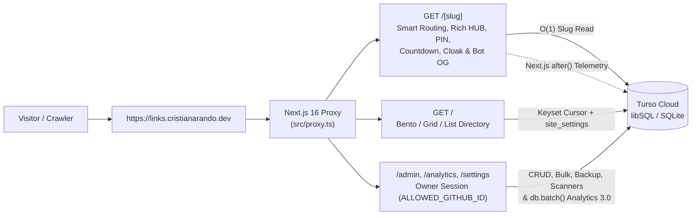

# InsideLink v2 — Engineering & Architecture Documentation Suite

> **System:** `inside-link` — Single-Owner Shortlink Engine, Rich Project HUBs, Theme Studio & Analytics 3.0  
> **Canonical Production Origin:** `https://links.cristianarando.dev` (Companion to `https://cristianarando.dev`)  
> **Edition:** InsideLink v2 (100% English · Dark-Only UI · Zero External API Keys)

---

## 1. Executive Summary

**InsideLink v2** is a standalone, high-precision shortlink and micro-landing platform built with **Next.js 16.4.3 (App Router + `src/proxy.ts`)**, **React 19.3**, **Turso (`@libsql/client` SQLite)**, **Drizzle ORM**, **Better-Auth (GitHub OAuth)**, and **Tailwind CSS v4**.

Operating on **`https://links.cristianarando.dev`**, `/` serves the public Bento Mosaic directory (`/links` permanently redirects `308` → `/`), `/[slug]` powers sub-50ms smart redirects and themed SSR project micro-landings, and `/admin` provides a keyboard-first owner console (`Cmd+K`) with real-time telemetry and visual customization.

### Architecture & Request Flow Overview

---

## 2. Core v2 Capabilities & Invariants

1. **Standalone Subdomain & Next.js 16 Proxy (`src/proxy.ts`):** Direct deployment on `links.cristianarando.dev` eliminates cross-project reverse-proxy rewrites and asset collisions while applying `nosniff`, `strict-origin-when-cross-origin`, and preview-host `noindex` headers.
2. **Single-Owner GitHub OAuth (Zero External API Keys):** Locked fail-closed via Better-Auth `databaseHooks` to `ALLOWED_GITHUB_ID` / `ALLOWED_GITHUB_EMAIL`. External Bearer tokens are intentionally omitted.
3. **Theme & Customization Studio (`/admin/settings` & `theme_json`):** 6 curated dark presets (`obsidian-emerald`, `midnight-cyan`, `cosmic-violet`, `solar-amber`, `crimson-oxide`, `arctic-mono`), custom `#RRGGBB` accents, surface tones (`obsidian`, `graphite`, `midnight`), card styles (`glass`, `bordered`, `minimal`), Bento/Grid/List public layouts, live status badges, and per-link theme overrides.
4. **Rich HUB Micro-Landings (`type = 'HUB'`):** Polymorphic blocks supporting `button`, live cached `github-repo` cards (stars, forks, language), zero-tracker Click-to-Play `youtube` (`youtube-nocookie.com`) and `spotify` facades, copyable `code` snippets, and `callout` notices—all wired with per-block CTR beacons.
5. **Smart Conditional Routing, Scheduling & Cloaking:**
   - **Smart Routing (`routing_rules_json`):** Routes visitors dynamically by `Country`, `Accept-Language`, `Device`, and `OS`.
   - **Scheduled Launch (`starts_at`) & Expiration Fallback (`expired_redirect_url`):** Live `dd : hh : mm : ss` countdown before launch and optional `307` fallback redirect after expiration or `max_clicks` exhaustion.
   - **Clean Fullscreen Cloaking (`is_cloaked`) & Health Scanner:** Borderless `100vw × 100dvh` iframe mode backed by SSRF-safe `X-Frame-Options` / CSP `frame-ancestors` checks (`/api/v1/links/frame-check`) and destination latency/status probes.
6. **Admin Productivity & `O(1)` SQL Analytics 3.0:** Global `Cmd+K` Command Palette, multi-select Bulk Actions, Click Reset, non-destructive Dry-Run JSON Backup/Restore, and single-roundtrip `db.batch` analytics featuring KPIs, period deltas, `90d` GitHub-style activity heatmap, `24h` UTC distribution, Top 10 Cities, HUB block CTR, zero-PII Live Clicks Stream, and UTF-8 CSV export.

---

## 3. Documentation Suite Index

| Document                                                             | Scope & Engineering Contents                                                                                                                                                  |
| :------------------------------------------------------------------- | :---------------------------------------------------------------------------------------------------------------------------------------------------------------------------- |
| [`01-product-requirements.md`](01-product-requirements.md)           | Product vision, v1 → v2 evolution, actor permissions, Functional Requirements (`FR-001`–`FR-017`), and Non-Functional Requirements (`NFR-001`–`NFR-006`).                     |
| [`02-system-architecture.md`](02-system-architecture.md)             | Standalone topology, `src/proxy.ts` behavior, `after()` telemetry pipeline, C4 diagrams (Context, Container, Domain Services), and repository tree.                           |
| [`03-data-model-and-invariants.md`](03-data-model-and-invariants.md) | SQLite/libSQL conventions, ERD (`site_settings`, `links`, `click_events`, `pin_attempts`, Better-Auth tables), JSON contracts, index registry, and keyset cursor SQL.         |
| [`04-api-and-redirect-engine.md`](04-api-and-redirect-engine.md)     | Slug normalization & blacklist pipeline, `GET /[slug]` resolution sequence diagram, Smart Routing & Rich HUB rendering rules, and `/api/v1/*` REST contract matrix.           |
| [`05-security-and-operations.md`](05-security-and-operations.md)     | Single-owner GitHub lock, zero-API-key policy, SSRF outbound guards, `scrypt` + HMAC PIN cookies, zero-PII telemetry, environment variables, Turso seed safety, and QA gates. |
| [`decisions/stack-versions.md`](decisions/stack-versions.md)         | Architecture Decision Record (ADR) documenting exact pinned runtime and package versions in `package.json` and `pnpm-lock.yaml`.                                              |

---

## 4. Visual Showcase Assets

High-DPI UI screenshots referenced in the root [`README.md`](../README.md) live in [`docs/screenshots/`](screenshots/) and can be regenerated via [`scripts/capture-screenshots.mjs`](../scripts/capture-screenshots.mjs) and [`scripts/capture-admin-screenshots.mjs`](../scripts/capture-admin-screenshots.mjs).
